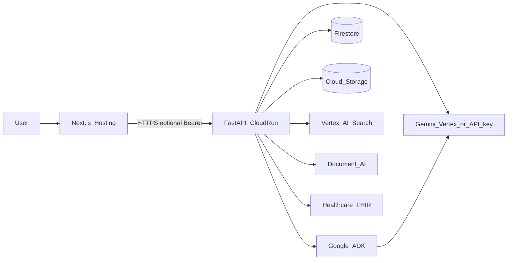

# Architecture — JIVANA

**Product detail:** [product/jivana-design-and-operations.md](product/jivana-design-and-operations.md)  
**Technology decisions:** [architecture/technology-decision-process.md](architecture/technology-decision-process.md)

## Overview

JIVANA is a **monorepo**: Next.js (static export → Firebase Hosting) and FastAPI (Cloud Run). All Gemini and Google Cloud AI calls run **server-side**; the browser talks only to the API.

Cloud Run service name in GCP remains **`ai-hackathon-api`** (historical); the product name is **JIVANA**.

## System diagram

## Primary request flows

| Flow | Path |
|------|------|
| **Med rec (MVP)** | Upload → Document AI or text extract → Vertex structured extract → reconciler → Firestore job → per-item review → finalize → optional FHIR Bundle |
| **Copilot / research / meetings / workflows** | Firestore session (optional) → institutional corpus + search tools → **ADK** or legacy Gemini templates |
| **Enterprise search** | Discovery Engine when configured + keyword corpus merge |
| **Platform** | Env-driven capability flags + optional live probes |

Med reconciliation is **deterministic** (rules + structured extract); it is **not** driven by open-ended ADK agents.

## Implemented vs extension

| Area | Status | Location |
|------|--------|----------|
| ADK agents | **Implemented** | `backend/app/ai/adk/` |
| Versioned prompts | **Implemented** | `backend/app/ai/prompts/v1/` |
| Copilot sessions | **Implemented** | Firestore + `session_store.py` |
| Vertex Agent Engine | **Env stub only** | `agent_engine_client.py` → in-process ADK |
| RAG / embeddings | **Not implemented** | Extension on `GeminiService` |
| SMART OAuth token exchange | **Not implemented** | Launch + configuration only |

## Security model

- Secrets and `GEMINI_API_KEY` only on the backend (Cloud Run / Secret Manager).
- Frontend `NEXT_PUBLIC_*` is non-secret configuration.
- Never commit service account JSON or `.env` files.
- Client Firestore/Storage rules are deny-all; data access via Admin SDK on the API.

See [security-defaults.md](security-defaults.md).
